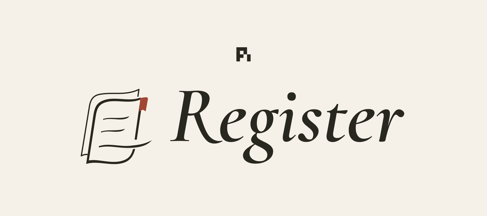
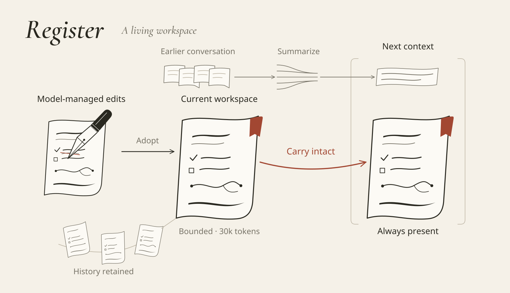

# Register



## Let your agent think. Keep your repository for the work.

Plans, debugging notes, half-formed ideas, decisions to revisit—an agent needs
somewhere to work things out. That shouldn't have to mean another `NOTES.md`,
`PLAN.md`, or `scratch.md` in your project.

**Register gives that work a home:** one living, model-managed workspace that stays
in context as the conversation moves on. A [pi](https://github.com/earendil-works/pi)
extension, with no extra model service and no required note format.

[](https://github.com/huahuadeliaoliao/pi-register/actions/workflows/ci.yml)
[Architecture](arch.md) · [Changelog](CHANGELOG.md) · [Releases](https://github.com/huahuadeliaoliao/pi-register/releases)

## Get started

Requires **Node.js 22.19.0+** and pi. The pinned development and integration-test
baseline is **pi 1.4.0**; other host versions are not implied by the broad peer ranges.

```sh
pi install git:github.com/huahuadeliaoliao/pi-register@v0.1.0
```

Start a new pi session, or run `/reload` in an existing one. Register supplies the
workspace and editing tools automatically. There is no setup prompt, manual loading
step or schedule to configure.

To see what your agent is keeping:

```text
/register
```

This opens a read-only snapshot. Scroll with arrow keys, Page Up/Down or Home/End;
press Esc to close. Looking does not call a model or add a message to the conversation.
In RPC mode, the command sends a plain-text notification instead.

Prefer to follow development? Install without `@v0.1.0`. A tag-pinned installation
stays on that release; updating it does not silently switch to a newer tag.

## A workspace, not a pile of notes.

Register is not an ever-growing log. Your agent can revise a hypothesis, combine
related findings, remove an obsolete plan or keep a rough draft for later. Previous
revisions remain recoverable without making every past thought part of the current
workspace.

**Keep the README. Lose the scratch-file sprawl.** Register is for working
material—not a replacement for documentation people actually need. Requested
reports, useful project docs and deliverables still belong in the project. Register
gives the model a better place for its own notes; it does not block file creation.

## Already in context. Never a scavenger hunt.

The full current workspace is automatically present. No filename to remember, notes
directory to search or retrieval call to make before continuing the work.

When the conversation is compacted, ordinary history can be summarized while
**Register's current contents carry forward unchanged**. The first request after
compaction already has them.



## Your agent's workspace. Not our template.

A debugging trail. Discussion takeaways. The reason behind a constraint. A tentative
plan with an exception to revisit. Fragments, exact values, sketches of an answer.

There are no mandatory sections, fixed entry types or per-turn updates. The model
decides what matters, how to organize it and when to revise it. **Freedom to think;
room to change its mind.**

## Cache-conscious by design.

**Stable when unchanged, careful when updated.** Register minimizes unnecessary
disruption to prompt caching—not the cost of change itself.

Unchanged content stays stable in context. The first write from a fresh empty
workspace preserves the existing prefix while its initialization record remains in
place. Later edits and conversation compaction can still affect cache reuse;
actual savings depend on the host and provider. See the [cache design](arch.md#cache-conscious-not-cache-free).

## What stays under the hood

- **One workspace per session.** Resume it, navigate branches or fork the conversation
  without turning unrelated sessions into shared mutable memory.
- **A bounded current page.** Up to 30,000 Register tokens, measured with a fixed
  local tokenizer. Over-capacity edits are rejected whole, not silently truncated.
- **Recoverable changes.** Clear and restore create new states without deleting
  earlier revisions. Restoring notes does not roll back your code.
- **Three model tools.** `register_write` maintains the body; `register_history` and
  `register_restore` recover earlier content when needed. No tool call is needed to
  read the current body.
- **No extra thinking service.** Register adds no background reflection model,
  cache-warming requests or separate cloud account. Ordinary conversation compaction
  still uses pi's summary mechanism.

The 30k capacity is **not extra context** and is not the selected provider's billing
tokenizer. The body still needs to fit alongside the prompt, tools and conversation.
Register keeps it intact rather than squeezing it into a model window that is too small.

## Your data

Persistent revisions are stored at:

```text
${PI_CODING_AGENT_DIR:-~/.pi/agent}/register/revisions.sqlite
```

The body is also stored in the native session file, and **is sent to your active
model provider as part of context**. Register adds no separate telemetry or sync
service. Treat its contents like conversation data, not a secrets vault.

- Clearing the current body is **not** history erasure. Old revisions and tool
  history can still contain earlier text; session exports/shares may include it.
- A consistent session-file copy can recover the current body. Full revision history
  also needs the SQLite data. Back up a live WAL database consistently, not just its
  main file.
- `--no-session` keeps Register body/history in memory rather than adding them to
  the regular database. Use one active writer per persistent session file.

## Compaction extensions

Register works on its own. If another extension also produces compaction results,
load order is not enough: it must cooperate with Register's final-checkpoint
coordinator. Uncoordinated compaction handlers are unsupported.

The [architecture](arch.md#other-compaction-extensions) describes the producer protocol
and the included [pi-compact-model adapter patch](compat/pi-compact-model.patch).
The patch targets that extension's matching pre-coordination 0.1.0 source, not pi core.
A checkpoint-carrier update can appear as a compaction card in pi even though no
additional summary-model call was made.

## Development

```sh
git clone https://github.com/huahuadeliaoliao/pi-register.git
cd pi-register
npm ci
npm run validate
```

Validation runs lint, strict TypeScript checking, deterministic tests and package
inspection. Tests use disposable workspaces, isolated pi directories, synthetic
providers and local transport fixtures—not your personal sessions or real models.
They include a separate packed-package installation, compaction and cold-recovery
workflow. CI runs on Node.js 22.19 and 24.

Use `npm run format` for formatting, or `npm run lint`, `npm run check`, `npm test`
and `npm run pack:check` individually. Pi loads the TypeScript entry point directly;
there is no build step. For a one-off local session after `npm ci`:

```sh
pi -e .
```

GitHub releases are the distribution channel. `private: true` deliberately prevents
accidental npm publication; it does not prevent installing from GitHub.

### Artwork

**Thought turns a page; the line continues.** The preceding leaf leaves a trace,
the vermilion tab marks the current page, and the ink carries on through its open edge.
The architecture illustration follows the same visual language.

Editable generators and original font sources are included. To regenerate the
existing assets with [uv](https://docs.astral.sh/uv/):

```sh
uv run --no-project --with fonttools --with pillow --with cairosvg python tools/brand/build_logo.py
uv run --no-project --with fonttools --with pillow --with cairosvg python tools/figures/build_architecture.py
```

Both scripts accept `--output /path/to/directory`. They require Cairo and Pillow
with Raqm support; none of these artwork dependencies is used by the extension.
SVG text is outlined, so viewing the finished images needs no installed fonts.

## License

[MIT](LICENSE) © 2026 huahuadeliaoliao. Bundled Cormorant and Noto Sans font sources
retain their SIL Open Font Licenses in `tools/brand/fonts/`. The small pi affiliation
mark uses the [official pi geometry](https://pi.dev/logo-auto.svg); Register is an
independent extension.
